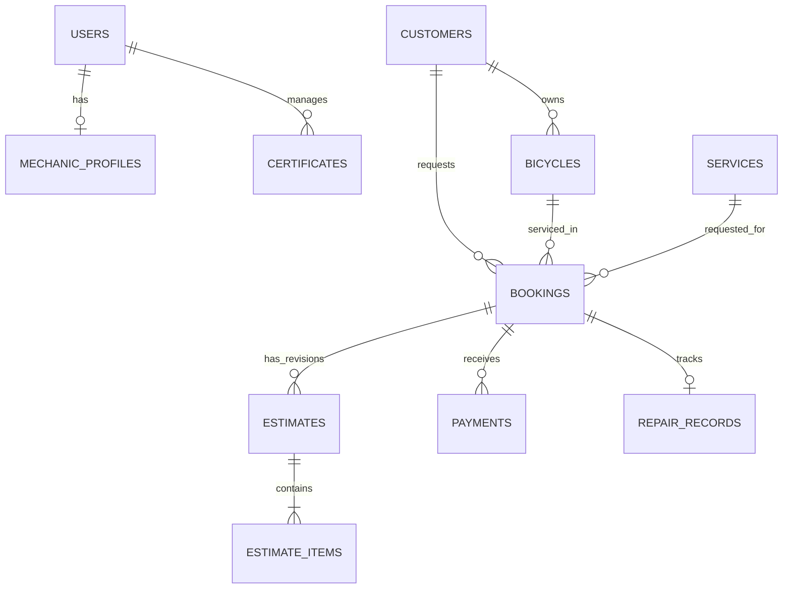

# Bicycle Mechanic Booking System — Project Plan

This document records the current implementation choices and remaining deployment decisions. Review the policies below before accepting real customers.

## Product scope

The system combines a public mechanic portfolio and service catalog with a customer booking/status flow and a private mechanic dashboard. MySQL is the source of truth for services, bookings, estimates, payment records, and repair history.

### Current implementation choices

- One mechanic administrator; no staff roles or multiple workshops.
- Customers can select multiple services for one booking. Service names, prices, and durations are snapshotted for the booking.
- Customers can submit a grouped request for up to ten bicycles. Each bicycle has its own service selection, problem, preferred drop-off, and up to three private photos of up to 10 MB each. Booking, approval, capacity, and repair status remain per bicycle.
- Each group selects combined or separate manual payment. Combined submission is enabled after all bicycles are approved; one mechanic verification confirms all group payments. Separate mode uses the existing per-booking payment flow.
- Multiple customers can register with unique email addresses. Every customer booking is linked to the signed-in customer account; backend queries scope customer data by the authenticated user ID. Admin accounts are created privately and cannot be selected during public registration.
- A request starts as `pending_review` and does not reserve capacity. Mechanic approval reserves both the chosen drop-off window and the service-duration capacity.
- The temporary payment reservation expires after two hours if payment is not submitted. Submitted proof holds the reservation until mechanic verification or rejection.
- Payment is manual e-wallet/bank-transfer proof submission; a customer-supplied receipt is never trusted as verification. Full mechanic-verified payment changes the booking to `confirmed`.
- The private workshop address is returned only to the owner of a fully paid booking. The mechanic configures the address in the admin workspace.
- The schedule uses Asia/Manila by default, a configurable repair-minute capacity (initially 600 minutes/day), drop-off intervals, and maximum bicycles per drop-off slot (initially one).
- Customers may upload payment proof. Automatic payment-provider/card processing, provider webhooks, and email delivery are not configured.

These are implementation defaults, not payment-provider or deployment approvals. Configure the mechanic's real schedule and address, and select a legitimate payment provider before enabling automatic e-wallet/card processing.

## Customer and mechanic workflow

1. Customer browses the mechanic profile and active services.
2. Customer submits one or more bicycles, choosing services, describing the issue, setting a separate preferred drop-off time, and optionally attaching photos for each bicycle. The customer chooses combined or separate payment.
3. Backend validates the request and creates it for the signed-in customer. Status is `pending_review`.
4. Mechanic reviews the request, asks for information, rejects it, or proposes an appointment/inspection plan.
5. Mechanic approves with a drop-off time or rejects/asks for more information. Approval is rejected if the date lacks repair capacity or the drop-off limit is reached.
6. The customer submits payment proof during the two-hour reservation window, either for each bicycle or once for the fully approved group. The mechanic verifies or rejects it.
7. Full verified payment confirms the appointment and permits the customer to view the private workshop address.
8. Mechanic records bicycle intake, condition, and notes; repair status moves through allowed transitions.
9. Additional work requires an estimate revision and customer approval before proceeding.
10. Mechanic records completed work, final charges, balance, pickup, release time, and completion.

## Preliminary data model



| Table | Purpose and key relationships |
| --- | --- |
| `users` | Customer and mechanic accounts; unique email, bcrypt password hash, role, active flag. Public registration can only create customer rows. |
| `mechanic_profiles` | Public biography, expertise, contact/service-area details; one-to-one with the mechanic user. |
| `certificates` | Public qualification records managed by the mechanic user. |
| `services` | Editable public offerings, starting price (`DECIMAL`), estimated duration, inspection flag, active flag. |
| `bookings` | Booking reference, user and service foreign keys, bicycle details, problem, requested and confirmed appointment times, booking status. |
| `estimates` | One row per estimate version; booking FK, revision number, status, total (`DECIMAL`), validity, customer decision timestamp. Preserve earlier versions. |
| `estimate_items` | Labor/parts/other lines belonging to an estimate, quantity, unit price and line total using fixed precision. |
| `payments` | Booking FK, method, amount, transaction reference, submission/verification timestamps, status and mechanic verifier. Never store payment passwords. |
| `repair_records` | One repair lifecycle per booking: intake notes/time, repair status, completed work, final charge, paid amount and release time. |
| `availability_schedules` / `unavailable_dates` | Weekly hours, breaks, daily repair-minute capacity, drop-off intervals/limits, and closures. |

Use InnoDB, foreign keys, UTC timestamps (with an explicit workshop timezone setting for presentation), `DECIMAL` for money, unique booking references, unique `(booking_id, revision)` estimates, and indexes for status/date/customer queries. Use transactions for operations that update related records. Avoid hard deletes of bookings, estimates, or payments; retain history and use inactive/archived flags for editable catalog data.

## Statuses and invariants

- Booking: `pending_review`, `awaiting_customer_response`, `awaiting_customer`, `rescheduled`, `awaiting_payment`, `payment_submitted`, `payment_rejected`, `confirmed`, `in_progress`, `completed`, `rejected`, `cancelled`, `no_show`.
- Estimate: `draft`, `sent`, `accepted`, `declined`, `superseded`, `expired`.
- Payment summary: `pending`, `partially_paid`, `paid`, `refunded`, `expired`; payment transactions have separate submission/verification states.
- Repair: `not_started`, `inspecting`, `awaiting_approval`, `in_progress`, `ready_for_pickup`, `released`.

The backend enforces allowed transitions. A submitted receipt/reference never verifies payment by itself. `awaiting_payment` and `payment_submitted` bookings hold capacity; pending requests do not. Verified full payment is required before confirmation and private-location access. Availability checks and approval are protected by a database transaction and schedule-row locking.

## Folder direction

The existing repository contains a Vite React starter at its root and empty `FRONTEND` and `BACKEND` directories. Keep the current starter intact while preparing a controlled move into `FRONTEND`; do not replace working source files. Target structure:

```text
FRONTEND/  # existing Vite app, React pages/components/API client
BACKEND/   # Express app, MySQL config, routes, business logic
  database/migrations/
  database/seeds/
README.md  # setup, environment, database initialization, project status
PROJECT_PLAN.md
```

Frontend `.env` must contain only public configuration such as the API base URL. Database credentials and secrets belong in `BACKEND/.env`, which must be ignored by Git; commit only `.env.example` placeholders.

## API outline

| Method and path | Access | Purpose |
| --- | --- | --- |
| `GET /api/services` | Public | List active services. |
| `GET /api/profile` | Public | Read public mechanic profile and hours. |
| `GET /api/availability?date=...&serviceId=...` | Public | Return candidate times; final check occurs when confirming. |
| `POST /api/bookings` | Public, rate limited | Validate and create a pending request; return reference and private token once. |
| `GET /api/bookings/mine` | Customer session | List only the authenticated customer's bookings. |
| `POST /api/bookings` | Customer session | Create a booking associated with the authenticated customer. |
| `POST /api/admin/auth/login` | Admin login | Create secure administrator session. |
| `GET /api/admin/bookings` | Admin | Review and filter bookings. |
| `PATCH /api/admin/bookings/:id/review` | Admin | Approve, reject, ask for information, or propose time. |
| `POST /api/admin/bookings/:id/estimates` | Admin | Create a versioned estimate. |
| `PATCH /api/admin/payments/:id/verification` | Admin | Verify or reject payment with audit timestamp. |
| `PATCH /api/admin/bookings/:id/repair` | Admin | Apply a valid repair transition and record work. |

Admin endpoints require authenticated admin authorization. Customer endpoints scope all reads and changes using the authenticated user ID; never trust a customer ID supplied in the request body. Use parameterized MySQL queries and consistent validation/error responses.

## Phased implementation checklist

1. **Planning (current):** Confirm defaults and replace TBD business policies; finalize schema and status transitions.
2. **Setup:** Move the Vite app into `FRONTEND` without losing existing work; initialize the Express backend and environment examples; update root documentation and ignores.
3. **Portfolio:** Build responsive home/about/certificates/services pages and booking form using clearly labeled sample content.
4. **Database:** Add MySQL migration and seed scripts; verify schema with the configured MySQL instance.
5. **API:** Add DB pool, public profile/services, booking, availability, admin authentication, and review workflow.
6. **Integration:** Connect Axios frontend; show booking reference, private status view, loading and validation errors.
7. **Estimates/payments:** Add estimate revisions and decisions; manual payment submission and verification.
8. **Repairs:** Add intake, transitions, additional approval, pickup, release, and completion.
9. **Verification:** Execute and document API authorization, booking conflicts, workflow, data integrity, and responsive checks.
10. **Deployment:** Configure production secrets, HTTPS, backups, and hosting after local flows are verified.

## Immediate next implementation task

Restructure the existing Vite app into `FRONTEND` while preserving the starter source and package lock, then create a minimal CommonJS Express app under `BACKEND` with a health endpoint and `.env.example`. Install only required dependencies after the directory move is reviewed. MySQL connectivity should be added once local MySQL connection details are available; no credentials should be committed.
